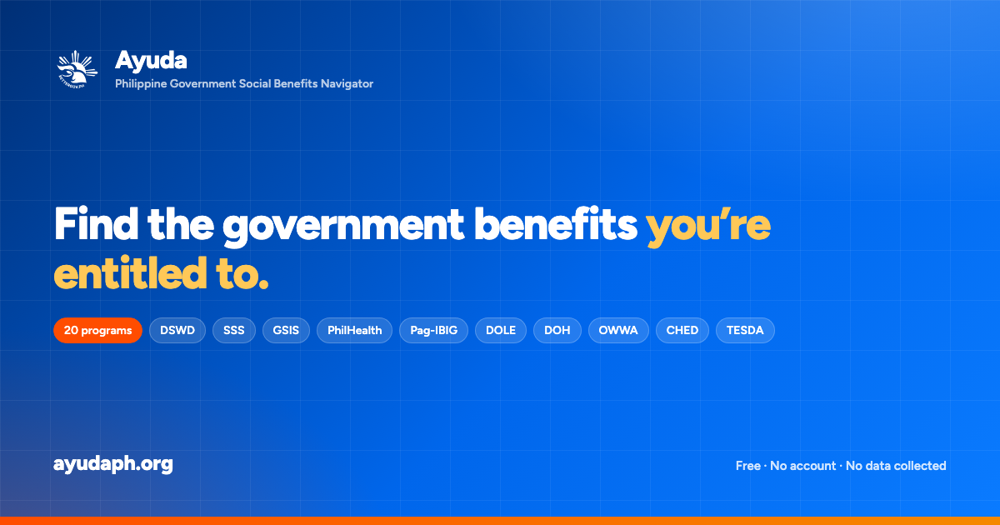

# Ayuda (ayudaph)

[](http://makeapullrequest.com)
[](https://opensource.org/licenses/MIT)
[](https://workers.cloudflare.com/)

<p align="center">
  
</p>

**Ayuda** is an open-source citizen initiative that helps Filipinos find, understand, and
apply for public welfare programs and social benefits — from **DSWD, SSS, GSIS, PhilHealth,
Pag-IBIG, DOLE, DOH, OWWA, CHED, and TESDA**.

> [!NOTE]
> Ayuda is an unofficial navigator. It is **not affiliated with, sponsored by, or endorsed by**
> the Government of the Philippines or any of its agencies.

---

## About this project

**Ayuda** is created and maintained by **Joshua Sarmiento**. It is an independent, open-source
civic tech project — no ads, no fees, no accounts, and no analytics.

- **Live site:** <https://ayudaph.org>
- **Source:** <https://github.com/fujiDevv/ayudaph>

The interface follows the design language of [BetterGov.ph](https://bettergov.ph) — the same type
scale, colour tokens, navigation pattern, and component vocabulary.

It runs as a **vinext** application: the Next.js App Router API surface implemented on top of
Vite, deployed to Cloudflare Workers.

---

## Features

- **Unified Benefits Directory** — searchable, filterable database of national welfare schemes,
  filterable by agency, category, and target audience.
- **Ayuda Finder** — a three-step eligibility wizard that scores every program against the
  visitor's employment status, area of need, and demographics.
- **Life Event Pathways** — six milestone bundles (having a baby, loss of a family member, job
  loss, retirement, entering college, solo parenting) with trackable checklists.
- **Shortlist & Requirement Tracker** — bookmark programs and tick off required documents, with
  progress persisted locally.
- **Agency Branch Locator** — interactive OpenStreetMap view of DSWD, SSS, GSIS, PhilHealth,
  Pag-IBIG, DOLE, DOH, and OWWA branches, with PSGC region/province filters and an Overpass API
  search.
- **Document Prep** — draft authorization letters, affidavits of low income, and request letters
  with a live A4 preview and print-to-PDF, plus step-by-step guides for prerequisite certificates.
- **Data Analytics** — KPI cards and interactive charts breaking the directory down by agency,
  category, audience, and tag.
- **Bilingual** — full English and Tagalog translations, switchable at any time.
- **Elder-friendly** — a large-text mode, plus print stylesheets for paperwork.
- **Progressive Web App** — installable, with an offline app shell and an offline fallback page.
- **Privacy-first** — no accounts, no analytics, no server-side storage. Everything the visitor
  enters stays in their browser's `localStorage`.

---

## Tech stack

| Concern         | Choice                                                             |
| --------------- | ------------------------------------------------------------------ |
| Framework       | [vinext](https://vinext.dev) — Next.js App Router on Vite          |
| UI              | React 19, TypeScript                                               |
| Styling         | Tailwind CSS v4 (`@theme` design tokens)                           |
| Icons           | `lucide-react`, `@icons-pack/react-simple-icons`                   |
| Maps            | Leaflet + OpenStreetMap standard tiles (no API key)                 |
| External data   | PSGC (regions/provinces), Nominatim (geocoding), Overpass API      |
| Testing         | Vitest                                                             |
| Package manager | pnpm                                                               |
| Hosting         | Cloudflare Workers                                                 |

---

## Getting started

### Prerequisites

- **Node.js 22+**
- **pnpm 11+** (`packageManager` is pinned in `package.json`)
- A Cloudflare account only if you intend to deploy

### Install and run

```bash
pnpm install
pnpm dev
```

The dev server starts on <http://localhost:3000>.

### Scripts

| Script                        | Description                                                    |
| ----------------------------- | -------------------------------------------------------------- |
| `pnpm dev`                    | Start the development server with HMR                          |
| `pnpm build`                  | Build the production Worker output                             |
| `pnpm start`                  | Serve the built output locally through Wrangler                |
| `pnpm og:image`               | Re-render the Open Graph share card (1200×630)                 |
| `pnpm test`                   | Run the Vitest suite once                                      |
| `pnpm test:watch`             | Run Vitest in watch mode                                       |
| `pnpm typecheck`              | Type-check the project without emitting files                  |
| `pnpm deploy`                 | Build and deploy the app Worker                                |
| `pnpm deploy:all`             | Deploy the response-store Worker, then the app (use this first) |
| `pnpm deploy:response-store`  | Deploy only the companion response-store Worker                |
| `pnpm setup:store-bucket`     | One-time: create the response store's R2 bucket                |

---

## Project structure

```text
├── app/                        # App Router routes
│   ├── layout.tsx              # Root shell: providers, fonts, Navbar, Ticker, Footer
│   ├── globals.css             # Design tokens (ported from BetterGov.ph) + base styles
│   ├── page.tsx                # Benefits directory (home)
│   ├── programs/[id]/page.tsx  # Program detail
│   ├── wizard/                 # Ayuda Finder
│   ├── pathways/               # Life event bundles
│   ├── assistance/             # Document generator + prerequisite guides
│   ├── locator/                # Branch map
│   ├── api/branches/           # Validated, same-origin Overpass lookup
│   ├── analytics/              # Charts dashboard
│   ├── hotlines/ shortlist/ about/ faqs/ contact/ search/ sitemap/
│   ├── offline/                # PWA offline fallback
│   ├── manifest.ts             # /manifest.webmanifest
│   ├── sitemap.ts robots.ts    # /sitemap.xml and /robots.txt
│   └── not-found.tsx
├── components/
│   ├── layout/                 # Navbar, Ticker, Footer
│   ├── ui/                     # Button, Card, PageHeader
│   └── <feature>/              # Feature UI (*Client.tsx files are interactive)
├── data/
│   ├── programs.json           # The benefits dataset (single source of truth)
│   ├── constants.ts            # Derived selectors, hotlines
│   ├── guides.ts, pathways.ts, navigation.ts
├── lib/
│   ├── filtering.ts wizard.ts analytics.ts   # Pure logic, unit tested
│   ├── store.tsx               # Saved programs, checklists, large text
│   ├── i18n/                   # en.json, tl.json + provider
│   ├── agency.tsx utils.ts types.ts site.ts
├── test/                       # Vitest suites
├── tools/
│   ├── og-image.html           # Open Graph share card template (1200x630)
│   └── generate-og-image.mjs   # Renders the template to a PNG via headless Chrome
├── public/
│   ├── sw.js                   # Service worker
│   ├── icons/ logos/svg/       # PWA icon and brand marks
│   ├── og/og-default.png       # Generated social share card
└── wrangler.jsonc              # Cloudflare Workers configuration
```

**Routing convention:** every `app/**/page.tsx` is a server component that exports `metadata` and
renders a matching interactive component from `components/<feature>/`. Anything using hooks,
state, or `localStorage` is marked `"use client"`.

---

## How the data works

`data/programs.json` is the single source of truth for the directory. Each entry drives the
directory cards, the detail page, the wizard, the pathways bundles, and the analytics charts.

Display copy, however, lives in the locale files. A program's `name`, `description`, `steps`, and
`requirements` are read from `lib/i18n/en.json` and `lib/i18n/tl.json` under `programs.<id>`, with
the JSON copy used as a fallback. This keeps translation review separate from dataset edits.

`test/data-integrity.test.ts` enforces this contract: every program in the dataset must have a
matching locale entry in **both** languages, with step and requirement counts that line up.

---

## Internationalization

- Translations live in `lib/i18n/en.json` and `lib/i18n/tl.json`.
- `useI18n()` exposes `t("some.dot.path")` for strings and `tm("some.dot.path")` for arrays.
- `{placeholder}` interpolation is supported — e.g. `t("finder.step", { step, total })`.
- Missing keys fall back to English, then to the key itself.
- The visitor's choice is persisted under `ayuda_locale`.

A test asserts that the English and Tagalog files expose an identical key set, so a half-finished
translation fails CI rather than silently rendering English.

---

## Theming

The design system is defined once in `app/globals.css` using Tailwind v4 `@theme` tokens, ported
directly from BetterGov.ph:

| Token family  | Purpose                             |
| ------------- | ----------------------------------- |
| `primary-*`   | Blue — primary actions, links       |
| `secondary-*` | Orange — DSWD accent, secondary CTA |
| `accent-*`    | Gold — bookmarks, highlights        |
| `success-*` `warning-*` `error-*` | Semantic states       |
| `gray-*`      | Neutral surfaces and borders        |

Prefer these tokens over raw palette values so the site stays visually consistent. Note that
dynamic class names must appear as **literal strings** in source — Tailwind's scanner cannot see
classes assembled at runtime.

The interface is intentionally **light-only**, matching BetterGov.ph. The elder-friendly
large-text mode adds a `large-text` class to `<html>`.

---

## Offline and PWA

`public/sw.js` precaches the app shell and serves it when the network is unavailable:

- **Navigations** — network-first, falling back to the cached page, then `/offline`.
- **Client navigation payloads (RSC)** — network-first with exact request and header matching;
  previously fetched payloads work offline, while uncached routes lead to the offline page.
- **Static assets** — stale-while-revalidate.
- **Cross-origin requests** — never cached, so live map and agency data stays fresh.

The worker is registered in production builds only, so it can never serve stale chunks over HMR.

The branch locator sends map bounds to `/api/branches`, which queries independent public
Overpass providers from the server. This avoids browser restrictions on third-party API requests.
Each provider has a 40-second deadline covering queueing, query execution, and transfer. Successful
responses allow short-lived HTTP caching; failed or incomplete searches are never cached as empty
results. The initial map loads a dated Metro Manila fallback immediately; live lookup runs when
the visitor searches the map or selects a province. Available locations remain visible if live
lookup is unavailable. Live results are limited to government and insurance offices to avoid
matching roads, transport routes, and unrelated shops with agency abbreviations in their names.

`data/branch-fallback.json` contains **44 OpenStreetMap office locations** in the initial Metro
Manila map area, with the source date and attribution included. It is a partial geographic fallback,
not a nationwide agency directory. To refresh it, export the same bounding box from Overpass with
`out center tags`, then run `node tools/import-branch-fallback.mjs <export.json>`. Failed and partial
exports are rejected. This dataset is © OpenStreetMap contributors and distributed under the
[Open Database License](https://opendatacommons.org/licenses/odbl/1-0/), separately from the app's MIT license.

---

## SEO

- `/sitemap.xml` is generated by `app/sitemap.ts` and covers every static route plus all program
  detail pages.
- `/robots.txt` is generated by `app/robots.ts`.
- The canonical origin comes from `lib/site.ts`, which reads `NEXT_PUBLIC_SITE_URL` and otherwise
  defaults to `https://ayudaph.org`. Set it only to point a staging build somewhere else:

  ```bash
  NEXT_PUBLIC_SITE_URL=https://ayudaph.<account>.workers.dev pnpm build
  ```

### Social share card

`public/og/og-default.png` is a 1200×630 card used for `og:image` and the Twitter
`summary_large_image` card, applied site-wide and to every program page.

It is generated, not hand-drawn. To change the copy or palette, edit
`tools/og-image.html` (a self-contained HTML/CSS page sized to 1200×630) and re-render:

```bash
pnpm og:image
```

That script inlines the brand mark as a data URI and screenshots the template with headless
Chrome, so the result does not depend on `file://` asset permissions. It looks for Chrome in the
usual macOS and Linux locations — set `CHROME_PATH` if yours lives elsewhere. Re-run it whenever
the headline, program count, or colours change.

### URL shape

Program pages are served at `/programs/:id`. The short-form `/program/:id` is kept as a permanent
(308) redirect in `next.config.ts`, so shared, bookmarked, or hand-typed links resolve to the
canonical page rather than the 404 route. `test/legacy-urls.test.ts` locks both that redirect and
the program IDs themselves — renaming an ID silently breaks public URLs.

---

## Deployment

This app deploys as **two Workers**:

| Worker | Config | Role |
| ------------- | -------------------------------- | ---------------------------------------------------------- |
| `ayudaph` | `wrangler.jsonc` | The Next.js app itself |
| `ayudaph-response-store` | `wrangler.response-store.jsonc` | R2-backed response cache in front of the app |

The app Worker holds a `RESPONSE_STORE` **service binding** to the cache Worker. Service bindings
cannot reference a Worker that does not exist, so **the cache Worker must be deployed first** —
deploying the app alone fails with `code: 10143`.

### First-time setup

Authenticate, then create the cache Worker's R2 bucket. The bucket is *not* created automatically
by `wrangler deploy`; the store fails to deploy without it.

```bash
wrangler login
pnpm setup:store-bucket
pnpm deploy:all
```

`pnpm deploy:all` deploys the cache Worker and then the app, in that order. To run the steps
individually:

```bash
pnpm deploy:response-store
pnpm deploy
```

### Subsequent deploys

Once both Workers exist, the app can be updated on its own:

```bash
pnpm deploy
```

Re-run `pnpm deploy:all` after changing `wrangler.response-store.jsonc`, or any time the app
reports a `RESPONSE_STORE` binding error — that means the cache Worker is missing or out of date.

The Worker names, asset binding, and image bindings are already configured in both files; set
`account_id` there if your Wrangler login is associated with more than one account.

### Custom domain

Production runs at <https://ayudaph.org>, which is the default canonical origin in `lib/site.ts`,
so a normal deploy needs no extra configuration.

When attaching the domain in Cloudflare, bind it to the `ayudaph` Worker named in `wrangler.jsonc`.
Do **not** set the asset `not_found_handling` to `"single-page-application"` — this app serves real
metadata routes (`/sitemap.xml`, `/robots.txt`, `/manifest.webmanifest`) that SPA fallback would
swallow. The configuration here uses `"none"` with the vinext fetch handler.

The project ships **no analytics or trackers**. Visitor state — saved programs, requirement
checklists, large-text preference, language choice, pathway and guide progress — lives only in the
browser, under `ayuda_saved`, `ayuda_checked_reqs`, `ayuda_large_text`, and `ayuda_locale`.

---

## Testing

```bash
pnpm typecheck
pnpm test
pnpm build
```

The suite covers the pure logic that drives the product — directory filtering, wizard scoring,
analytics aggregation and donut geometry, the letter templates, and dataset/locale integrity.
Pure logic belongs in `lib/` so it can be tested without a DOM.

---

## Disclaimer

Ayuda is an independent, open-source project. It is **not affiliated, associated, authorized,
endorsed by, or in any way officially connected with the Government of the Philippines** or any of
its offices. All official names (DSWD, SSS, GSIS, PhilHealth, Pag-IBIG, DOLE, DOH, OWWA, CHED,
TESDA) and trademarks belong to their respective holders.

Program details are compiled from official public sources for general information only. Rules,
requirements, and deadlines change without notice — always verify with the official agency portal
linked on each program's page.

## License

Released under the [MIT License](./LICENSE). © 2026 Joshua Sarmiento.
